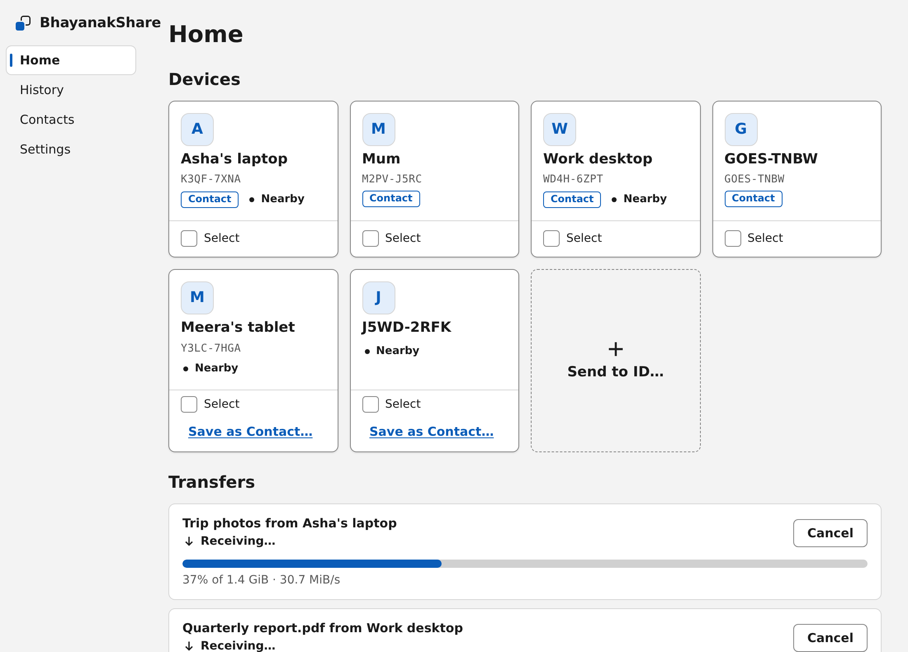
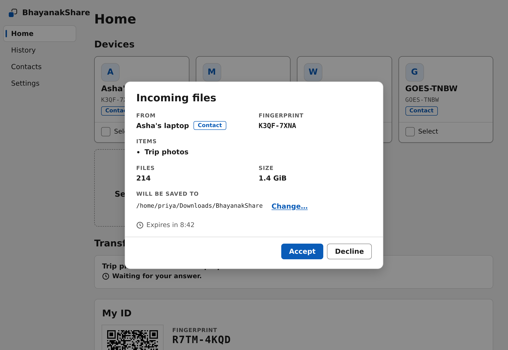
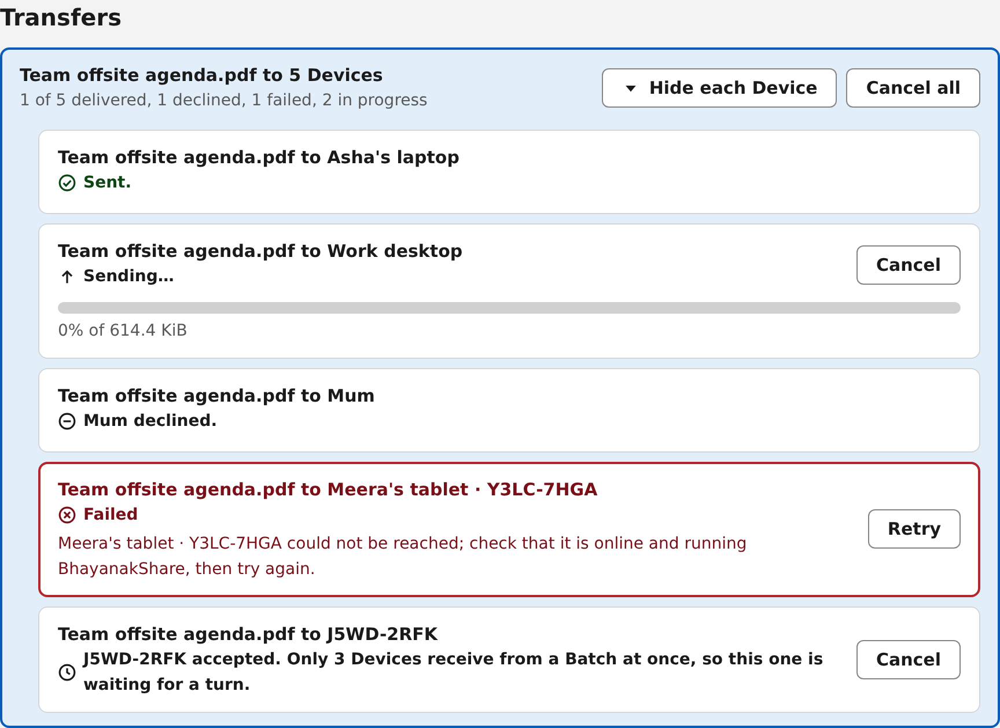
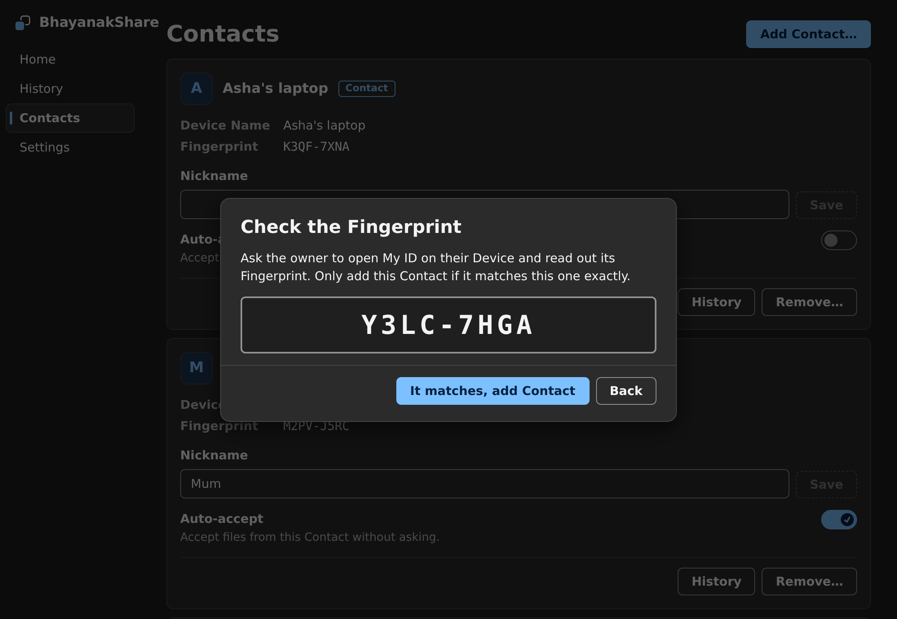
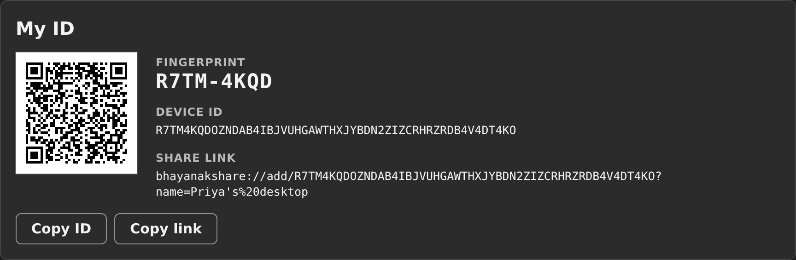
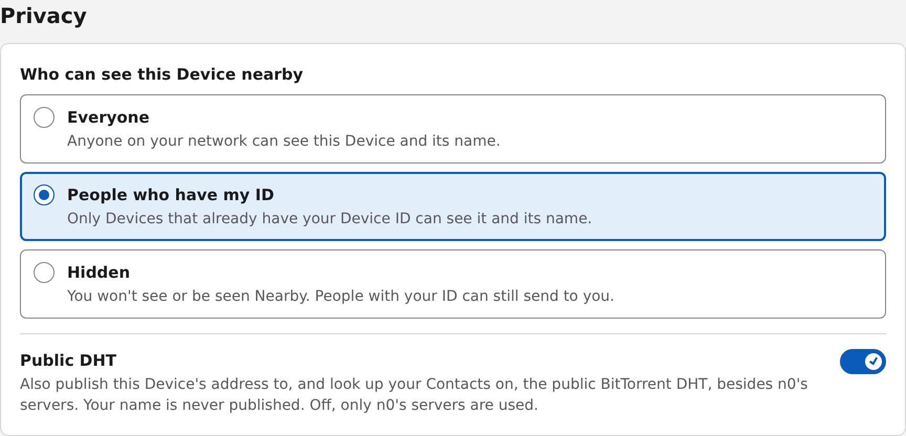
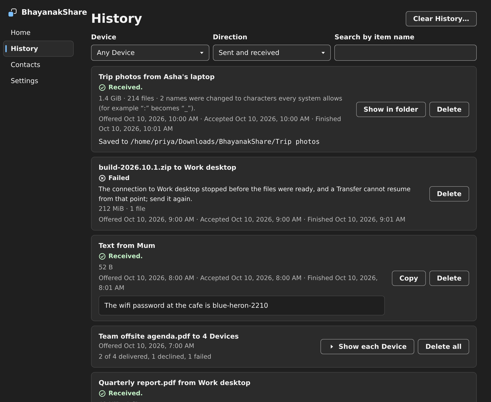

# BhayanakShare

**Your files, straight to their computer. Nothing in between.**

BhayanakShare sends files, folders and text from your computer to someone else's, like AirDrop for Windows and Linux. The people you know show up by themselves when you're on the same network. Anyone else is one pasted ID away, wherever they are.

No account. No cloud drive. No link that expires before they open it. They say yes, and it arrives.

👉 **[Download BhayanakShare](https://github.com/theHimanshuShekhar/bhayanakshare/releases/latest)**

---

## Why BhayanakShare?

### 📡 Nearby, automatically
Open the app and your Contacts on the same network appear as tiles, along with anyone who has chosen to be seen by everyone. Click one, choose your files, and they're on their way. Not on the same network? Paste their Device ID, open their share link, or scan their QR code, and send across the internet just the same.

### 🔐 Straight from you to them
Your files go directly from your computer to theirs, encrypted the whole way. Nothing waits on a server for someone to download it, and there's no account to sign up for. When a network won't allow a direct connection, an encrypted relay passes the data along. It can't read any of it.

### ✋ Nothing arrives without a yes
Every Transfer starts as an Offer. You see who it's from, their Fingerprint, what's in it, how big it is and where it will be saved, before a single byte moves. If there isn't enough space, or the paths would be too long for that folder, you're told before you accept, not halfway through. An Offer nobody answers expires after 10 minutes.

### 📁 Files, folders, and a quick bit of text
Send one photo or a whole folder tree, and the folders arrive the way they left. Need to pass on a Wi-Fi password or an address? Write a text instead. It shows up ready to copy.

### 👥 One send, many people
Tick a few tiles and send the same files to all of them at once. Each person gets their own Transfer and their own progress, so one slow Wi-Fi doesn't hold up everyone else. If one fails, retry just that one.

### 🔁 Picks up where it stopped
Laptop lid closed? Wi-Fi dropped? Computer restarted? A Transfer that's under way carries on when the two computers can reach each other again. No starting from zero.

### 🤝 Contacts you can trust
Save the people you send to as Contacts, give them a Nickname, and turn on Auto-accept for the ones you trust completely, like your own laptop. Adding someone means checking their Fingerprint with them, out loud or over a message, so you know it's really their computer.

<table>
  <tr>
    <td></td>
    <td></td>
  </tr>
  <tr>
    <td align="center">Check the Fingerprint before you add someone</td>
    <td align="center">Share your ID as a link or a QR code</td>
  </tr>
</table>

### 🙈 You decide who sees you
Choose who can see your computer nearby: **Everyone** on the network, only **People who have my ID**, or nobody at all (**Hidden**). Even Hidden, the people who have your ID can still send to you. Your computer's name is never published online.

### 📜 A History you can search
Everything you've sent and received is kept: who, what, when, and where it was saved. Filter by person or direction, search by name, open the folder it landed in, or send a failed one again.

### 🌙 Quiet in the background
Close the window and BhayanakShare keeps running in the tray, so files can still reach you. It can start when you log in, and it lets you know when something arrives.

### 🎨 Comfortable to use
Light or dark, following your system. Everything works from the keyboard, and with a screen reader. The layout holds up at 200% zoom and in Windows high-contrast mode. When something goes wrong, it tells you what happened in one plain sentence, and what to do about it.

### 🕵️ No tracking
No accounts, no analytics, no crash reports sent anywhere. The log stays on your computer, and you decide whether to share it. The only thing the app fetches on its own is the check for a new version.

### ⬆️ Keeps itself up to date
When a new version is out, BhayanakShare tells you, and on Windows and the AppImage it installs the update when you say so.

---

## Works where you are

- **Windows 11** (64-bit): one installer, no administrator rights needed.
- **Linux** (64-bit): AppImage, `.deb` (Ubuntu 22.04 and newer) and `.rpm` (Fedora 39 and newer).
- **macOS** isn't supported yet.

Both computers need BhayanakShare. Windows and Linux can send to each other.

**On Windows**, the installer isn't code-signed yet, so Windows warns before it runs. At "Windows protected your PC", choose **More info**, then **Run anyway**. If Smart App Control is on, it blocks unsigned installers outright, and you'll need to turn it off first; [the details are here](docs/development.md#installing-on-windows).

**Can't see anyone nearby?** A firewall may be blocking local discovery. [Here's how to allow it](docs/firewall.md) on Windows and Linux. Sending by Device ID works either way.

---

## How it works

1. **Install** BhayanakShare on both computers and give each one a name.
2. **Pick who to send to**: a nearby tile, a Contact, or a Device ID they gave you.
3. **Choose files, a folder, or write a text.** They accept, and it's done.

That's all there is to it.

---

  <b>Ready to send something?</b> 
  <a href="https://github.com/theHimanshuShekhar/bhayanakshare/releases/latest">Download BhayanakShare</a>

Made in <a href="https://t3.codes">T3 Code</a>. Building or contributing? See <a href="docs/development.md">docs/development.md</a>.

